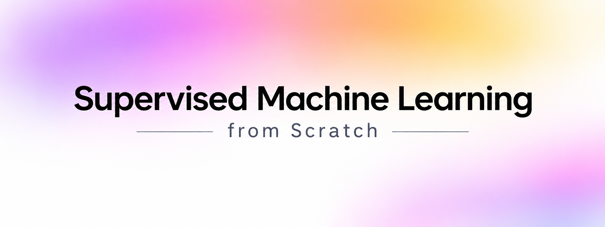

# Supervised Machine Learning from Scratch

<p align="center">
  
</p>

<p align="center">
  
  
  
  
</p>

Machine learning algorithms built from the ground up using only **Python, NumPy, Pandas, and Matplotlib**. No Scikit-Learn, no TensorFlow, no black boxes. Every gradient, loss function, and normalization step is written by hand.

**If you can build it from scratch, you truly understand it.**

> This is the math-first half of a two-repo system. After this, continue with [Supervised ML with Scikit-Learn](https://github.com/ather-ops/Supervised-ML-with-Scikit-Learn) to see the same concepts with production tools.

## Live Demos

| App | Built with | Link |
|---|---|---|
| House Price Predictor | Linear Regression | [Launch →](https://ather-ops-supervised-ml-fro-linear-regressionprojectsapp-g6x3xg.streamlit.app/) |
| Spam Detector | Logistic Regression | [Launch →](https://spam-ai.streamlit.app/) |

## Progress

| Algorithm | Status | Folder |
|---|:---:|---|
| Data Cleaning and Preprocessing | ✅ Complete | [`Data Cleaning and Preprocessing/`](<Data Cleaning and Preprocessing/>) |
| Linear Regression | ✅ Complete | [`linear-regression/`](linear-regression/) |
| Logistic Regression | ✅ Complete | [`logistic-regression/`](logistic-regression/) |
| K-Nearest Neighbors (KNN) | 🚧 Up next | [`KNN/`](KNN/) |
| Naive Bayes Classifiers | ⏳ Planned | [`Naive Bayes Classifiers/`](<Naive Bayes Classifiers/>) |
| Ridge and Lasso Regression | ⏳ Planned | [`Ridge and Lasso Regression/`](<Ridge and Lasso Regression/>) |
| Support Vector Machines | ⏳ Planned | [`Support Vector Machines/`](<Support Vector Machines/>) |

## What's Completed

### Data Cleaning and Preprocessing
The foundation for every model: handling messy data and preparing it for training, including scaling and normalization implemented by hand.

### Linear Regression
Regression from scratch with gradient descent, feature and target scaling, and evaluation using MAE, MSE, and RMSE.

**Project: House Price Predictor**

<p align="center">
  
</p>

- Trained on 545 housing records with five numerical features
- Custom train-test split
- Feature and target scaling
- Gradient descent training
- Saving and loading trained parameters
- Interactive Streamlit app ([live demo](https://ather-ops-supervised-ml-fro-linear-regressionprojectsapp-g6x3xg.streamlit.app/))

**Location:** [`linear-regression/Projects/`](linear-regression/Projects/)

### Logistic Regression
Binary classification from scratch using the sigmoid function, log loss (binary cross-entropy), and gradient descent.

**Project: Spam Detector**

- Classifies messages as spam or not spam
- Interactive Streamlit app ([live demo](https://spam-ai.streamlit.app/))

**Location:** [`logistic-regression/`](logistic-regression/)

## Getting Started

```bash
git clone https://github.com/ather-ops/Supervised-ML-from-scratch.git
cd Supervised-ML-from-scratch
pip install -r requirements.txt
```

**Run the student scores example:**

```bash
python "linear-regression/student_scores_example.py"
```

**Run the House Price Predictor locally:**

```bash
cd linear-regression/Projects
pip install -r requirements.txt
python train.py
streamlit run app.py
```

> `all_models.py` (a single entry point to run every model) will be added once more implementations are complete.

## Requirements

- `numpy>=1.21.0`
- `pandas>=1.3.0`
- `matplotlib>=3.4.0`
- `streamlit` (demo apps only)

## Roadmap

- [x] Data cleaning and preprocessing
- [x] Linear Regression
- [x] Logistic Regression
- [ ] **K-Nearest Neighbors** ← next
- [ ] Naive Bayes Classifiers
- [ ] Ridge and Lasso Regression
- [ ] Support Vector Machines
- [ ] `all_models.py` unified runner

## Learning Path

| Stage | Focus |
|:---:|---|
| 01 | Mathematics behind machine learning |
| 02 | Implementing algorithms from scratch |
| 03 | Training and evaluating models |
| 04 | Building practical ML projects |
| 05 | Understanding the engineering behind ML systems |

## Related Repository

| Repository | Purpose |
|---|---|
| [Supervised ML with Scikit-Learn](https://github.com/ather-ops/Supervised-ML-with-Scikit-Learn) | The same algorithms using Scikit-Learn, pipelines, and real projects |

## License

MIT License. Use freely.

## Author

[ather-ops](https://github.com/ather-ops)
