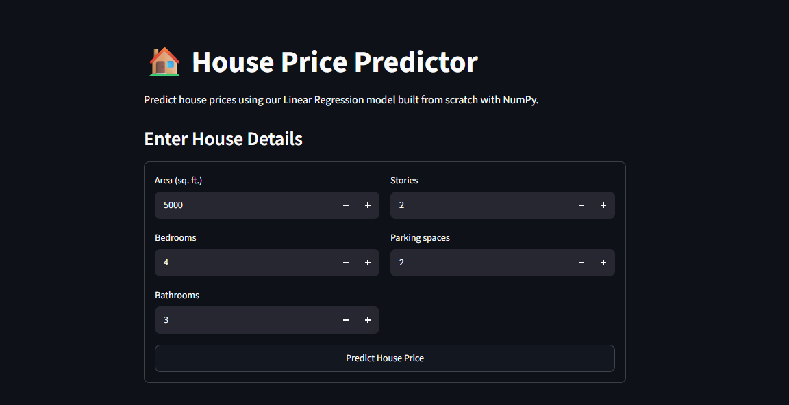
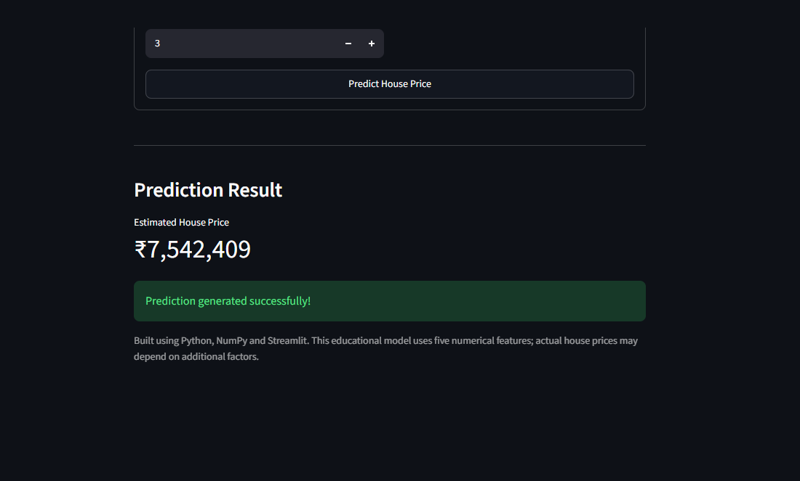

<p align="center">
  
</p>

A machine learning project that predicts house prices using **Linear Regression implemented from scratch with NumPy**.

Instead of relying on Scikit-learn for model training, this project implements the core mathematics behind Linear Regression, including gradient descent, parameter updates, feature scaling, prediction, and model evaluation.

The trained model is saved and integrated into an interactive Streamlit application.


##  Live Application

**House Price Predictor:** Run locally using Streamlit (instructions below).

Users can enter house details and receive an estimated house price based on the trained model.

##  Application Preview

The application provides a simple interface for entering house features and viewing predicted prices.

### Enter House Details


### Prediction Result

**Example prediction:** ₹7,542,409


##  What I Built

- Implemented Linear Regression from scratch using NumPy.
- Created a custom train-test split function.
- Implemented feature standardization and target scaling.
- Built gradient descent for model training.
- Implemented prediction using weights and bias.
- Evaluated the model using MAE, MSE, and RMSE.
- Saved trained parameters using NumPy's `.npz` format.
- Built an interactive Streamlit prediction application.

##  Dataset

**Dataset:** Housing Price Prediction Dataset

- Total records: 545
- Total columns: 13
- Missing values: 0
- Duplicate records: 0
- Selected features: 5
- Target variable: `price`

### Selected Features

| Feature | Description |
|---|---|
| area | House area |
| bedrooms | Number of bedrooms |
| bathrooms | Number of bathrooms |
| stories | Number of stories |
| parking | Number of parking spaces |

Categorical features are intentionally excluded from this initial implementation.

##  Model Implementation

The model was implemented using the following mathematical concepts.

**1. Linear Regression**

\[
\hat{y}=Xw+b
\]

**2. Mean Squared Error**

\[
MSE=\frac{1}{m}\sum_{i=1}^{m}(y_i-\hat{y}_i)^2
\]

**3. Gradient Descent**

Weights and bias are updated iteratively to minimize the loss.

\[
w=w-\alpha\frac{\partial J}{\partial w}
\]

\[
b=b-\alpha\frac{\partial J}{\partial b}
\]

**4. Feature Scaling**

Standardization is applied using training-set statistics to keep features on comparable scales and avoid data leakage.

**5. Model Evaluation**

The model is evaluated using:

- MAE — Mean Absolute Error
- MSE — Mean Squared Error
- RMSE — Root Mean Squared Error

### Initial Model Results

| Metric | Result |
|---|---:|
| MAE | ₹936,022.86 |
| MSE | 1,595,499,513,920.16 |
| RMSE | ₹1,263,130.84 |

These are initial baseline results using five numerical features and an 80/20 train-test split.


##  Project Architecture

```text
Projects/
│
├── data/
│   └── Housing.csv
│
├── models/
│   └── housing_linear_regression.npz
│
├── src/
│   ├── __init__.py
│   ├── preprocessing.py
│   └── model.py
│
├── app.py
├── train.py
├── requirements.txt
└── README.md
```

### Architecture Flow

```text
Housing Dataset
      |
      v
Data Inspection
      |
      v
Feature Selection
      |
      v
Train-Test Split
      |
      v
Feature & Target Scaling
      |
      v
Linear Regression
      |
      v
Gradient Descent Training
      |
      v
Model Evaluation
      |
      v
Save Model Parameters
      |
      v
Streamlit Application
      |
      v
House Price Prediction
```

##  DSA Connections

This project also connects machine learning with fundamental Data Structures and Algorithms concepts.

| Concept | Where It Is Used |
|---|---|
| Arrays | Storing features, weights, and predictions |
| Matrix Operations | Vectorized prediction and gradient calculations |
| Time Complexity | Understanding training and prediction costs |
| Iteration | Gradient descent training loop |
| Numerical Optimization | Minimizing the loss function |
| Data Manipulation | Splitting and processing dataset records |

### Complexity Analysis

Let:

- `m` = number of training samples
- `n` = number of features
- `E` = number of training epochs

| Operation | Time Complexity |
|---|---|
| Prediction | O(m × n) |
| MSE calculation | O(m) |
| One gradient descent update | O(m × n) |
| Complete training | O(E × m × n) |

Understanding these complexities helps explain how training cost changes as datasets and feature counts grow.

## System Design Connections

The project introduces several concepts used in larger machine learning systems.

### 1. Training and Inference Separation

Training happens in `train.py`, while `app.py` loads the saved model and performs inference.

This avoids retraining the model whenever a user opens the application.

### 2. Model Persistence

The trained parameters are stored in a `.npz` file:

- Weights
- Bias
- Feature means
- Feature standard deviations
- Target mean
- Target standard deviation
- Feature names

### 3. Training-Serving Consistency

The application uses the same preprocessing statistics that were calculated during training.

This ensures incoming data follows the same transformation pipeline.

### 4. Caching

Streamlit caching prevents unnecessary model loading during application reruns.

### 5. Future System Design Questions

As the project grows, we will explore:

- How to handle 1,000 simultaneous prediction requests.
- How to serve models through REST APIs.
- How to manage model versions and rollbacks.
- How to validate incoming prediction data.
- How to monitor model performance and data drift.
- How to deploy ML applications using Docker and CI/CD.

These are learning and future implementation topics, not claims that the current Streamlit application already supports production-scale traffic.


## 🛠️ Tech Stack

- Python
- NumPy
- Pandas
- Matplotlib
- Streamlit
- Git & GitHub

**Note:** Scikit-learn was not used to train the Linear Regression model. The core algorithm was implemented manually using NumPy.


## What's Next?

This project focuses on understanding Linear Regression from first principles.

The next stage is to explore how the same machine learning workflow can be implemented using industry-standard libraries.

### Next Repository: Supervised ML with Scikit-Learn

**Linear Regression — Part 02**

[Explore the next repository →](https://github.com/ather-ops/Supervised-ML-with-Scikit-Learn/tree/main/02-Linear-Regression)

In the next project, we will explore:

- Linear Regression using Scikit-learn.
- Pipelines and preprocessing.
- Model evaluation and comparison.
- Cross-validation.
- Hyperparameter tuning.
- More advanced ML engineering workflows.

We will also continue exploring DSA and system design concepts as the projects become more advanced.

##  Project Goal

The goal was not simply to build a house price predictor.

It was to understand how a machine learning model works internally, implement its mathematics, build a reusable training pipeline, save the trained model, and connect it to an interactive application.

**Learn the mathematics. Build the algorithm. Understand the engineering.** 

---

*Built as part of my journey into Machine Learning and ML Engineering.*
